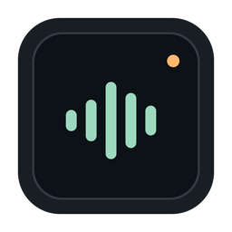

# EP Talk

Squeeze the handle on a Teenage Engineering EP-2350 to start dictation. Release it to finish. EP Talk reads short tones through the curly cable and presses the shortcut for Handy or another dictation app.

## Build and open

EP Talk runs on macOS 14 or later. Use Swift 6.2 or later to build it.

Run `./build.sh` from the project folder. Open `dist/EP Talk.app`. To run the tests, run `swift test` from the same folder.

## Set up the mic once

1. Connect the mic to your Mac with a USB-C data cable.
2. Squeeze the handle to turn on the mic.
3. In EP Talk, open `Mic Setup → Prepare Mic`.
4. Select `FX MIC DISK`.
5. Eject `FX MIC DISK` in Finder.
6. Unplug the USB-C cable.
7. With two AAA batteries installed, turn the mic off and on again.
8. Put the front cover back on.

EP Talk backs up visible files to `~/Library/Application Support/EP Talk/Mic Backups` before it installs the tones.

## Dictate

EP Talk needs an audio input that uses 48,000 Hz. You can set this rate in Audio MIDI Setup.

1. Plug the curly cable into the pink mic jack on the Sabrent adapter.
2. In EP Talk, select the adapter as the audio input. It usually appears as `USB Advanced Audio Device`.
3. Grant EP Talk access to Microphone and Accessibility.
4. In Handy, select the same audio input.
5. Set Handy and EP Talk to the same hold-to-talk shortcut. EP Talk defaults to Left Option + Left Command.
6. Click `Arm` in EP Talk.
7. When EP Talk shows `Ready`, click a text field.
8. Squeeze the handle.
9. When EP Talk shows `Transmitting`, speak.
10. Release the handle to finish.

To start EP Talk when you sign in, turn on `Open at login`.

## Fix common problems

If EP Talk stays at `Acquiring link`, turn the mic off and on again with USB-C disconnected. After you change the input rate, choose `Refresh Inputs` in EP Talk.

If Handy stays idle, try its shortcut on your keyboard. Make sure that Handy is open and uses the same input as EP Talk.

To remove the tones, use `Mic Setup → Remove Signals`. Eject the mic in Finder. Turn the mic off and on again.

## Credits

EP Talk uses parts of [FX Talk](https://github.com/bjg4/fx-talk). FX Talk uses parts of [Tingle](https://github.com/tutorintelligence/tingle). See `ThirdParty` for the MIT licenses.
